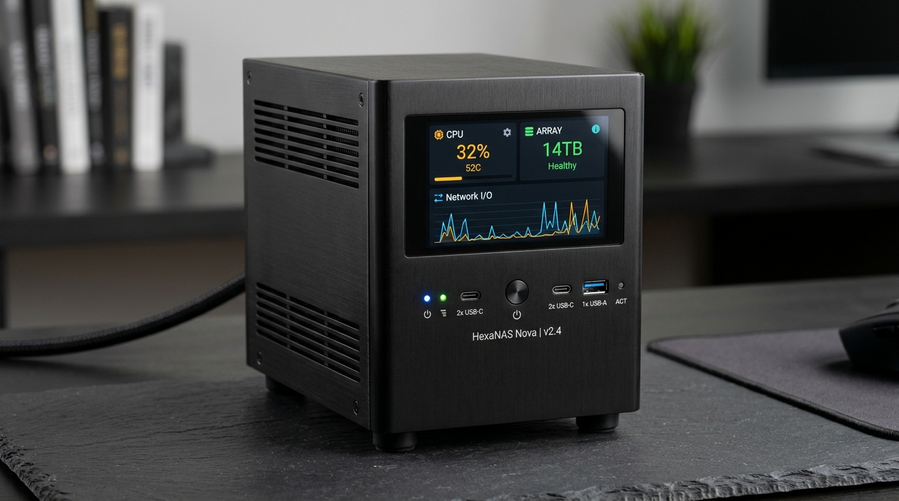
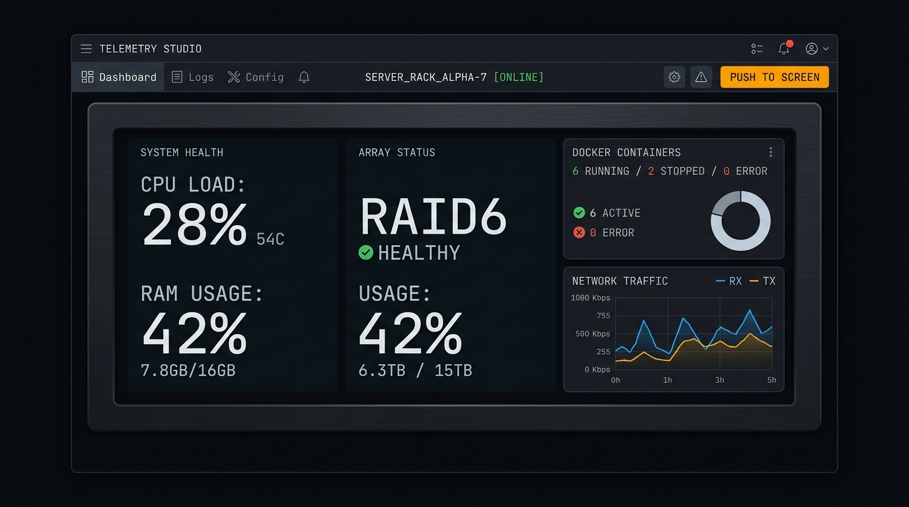

# Aoostar Display Studio

Open-source, local-first Dockerized telemetry monitor and **960×376 secondary USB-UART LCD studio** for **Aoostar NAS** hardware (WTR MAX / GEM12+ PRO, USB-UART `VID 0x0416`, `PID 0x90A1`), created and maintained by **JoshC1994**.

[](https://buymeacoffee.com/M50wCmpncp)


Repository: `https://github.com/JoshC1994/AOOSTAR_SCREEN_CONTROL`  
Container Image: `ghcr.io/joshc1994/aoostar_screen_control:latest`



---

## Why Aoostar Display Studio? (Security & Open Source)

Many mini-PC and NAS owners avoid proprietary OEM Windows display utilities because closed-source vendor binaries often bundle opaque background services, elevated privileges, or undocumented network calls. **Aoostar Display Studio** replaces OEM software with an auditable, 100% local Docker container:

- **Zero Cloud / Zero Phone-Home**: Runs entirely inside your LAN; no external analytics, telemetry, or vendor accounts.
- **Hardened Authentication & Network Guards**: Salted `scrypt` credential storage (`data/credentials.json` mode `0600`), LAN-only guard while using default credentials, login rate limiting, hashed API tokens, host-header & `Origin` CSRF validation, outbound SSRF IP/CIDR filtering, and magic-byte upload validation (SVG disabled).
- **Non-Root Container Execution**: `docker-entrypoint.sh` handles host volume & USB `/dev/ttyACM*` group permissions cleanly at boot and immediately drops privileges to UID/GID `1000:1000` (`node`) via `gosu`.
- **User-Agnostic Design**: Works cleanly on **Unraid** and standard **Linux Docker / Compose** hosts.

---

## Screenshots

### Studio Display Preview & Layout Editor
Clean live 960×376 showcase by default, with a **Test Rotate** browser preview button and an **Edit** toggle that reveals drag-and-drop blocks, themes, media uploads, and per-block styling.



---

## Key Features

- **Clean Screens Preview + Toggleable Studio Editor**: View your live 960×376 LCD frame distraction-free, test multi-screen cycling locally with **Test Rotate**, or click **Edit** to reveal Blocks, Themes, Media Library (PNG/JPG/WebP/GIF/MP4/WebM), Snap Grid, and the Block Inspector.
- **Unified Entities & Connection Wizard**: Built-in host telemetry plus a guided **Add Connection Wizard** for **Home Assistant** and **Custom HTTP / JSON APIs** (Pi-hole, Tautulli, solar inverters, UPS, etc.) with live endpoint testing and clickable JSON key detection.
- **One-Click Cards & Multi-Entity Graphs**: Select any exposed entity to place a **Number**, **Graph**, or **Gauge**, or select multiple entities at once to build a **Multi-Series Line/Area Graph**, **Bar Chart**, or **Number List** on any screen.
- **Organized Settings & Built-In Diagnostics**: Settings cleanly separates **Screens & Rotation** (hardware Auto-Rotate & dwell seconds), **Entities & Connections**, **Display & Hardware**, **Security**, and full **Diagnostics** (protocol dry run, safe `DISPLAY_ON` probe, and live TX/RX logs for fault-finding).
- **Native Node.js Diff-Cached USB-UART Driver**: Implements the `zehnm/aoostar-rs` protocol (`1,500,000` baud, `47B` chunks, `15,360` total chunks, `'A'` ACK, zero wire CRC) asynchronously inside Node.js without spawning external binaries per frame.
- **Host Hardware & Container Telemetry**: Reads CPU load/temp/power, GPU metrics (`nvidia-smi`, `intel_gpu_top`, `radeontop`, DRM sysfs), `lm-sensors` / `hwmon`, `/var/local/emhttp` array status (when mounted on Unraid), Docker containers, and SMB/SSH sessions.

---

## How to Install

### Option 1: Unraid (Community Applications / Docker Template)

1. In Unraid **Docker** -> **Add Container** (or Community Applications via `templates/aoostar-display-studio.xml`):
   - **Repository**: `ghcr.io/joshc1994/aoostar_screen_control:latest`
   - **WebUI Port**: `3000` -> `3000`
   - **Appdata**: `/mnt/user/appdata/aoostar-display-studio` -> `/app/data`
   - **Extra Parameters (included automatically by template)**: `--device=/dev/ttyACM0:/dev/ttyACM0 --group-add=20`
   - **Read-Only Host Mounts**:
     - `/sys/class/hwmon` -> `/sys/class/hwmon` (`ro`)
     - `/var/local/emhttp` -> `/var/local/emhttp` (`ro`, Unraid array stats)
     - `/var/run/docker.sock` -> `/var/run/docker.sock` (`ro`, optional; or use Docker Socket Proxy)
2. Start the container—no manual host `chown` or `--user` overrides needed (`docker-entrypoint.sh` repairs `/app/data` ownership and serial group access automatically before dropping to non-root via `gosu`).
3. Optional overrides: set `AOOSTAR_UID` / `AOOSTAR_GID` (defaults `1000` / `1000`, `0` is rejected) if you want custom file ownership.

### Option 2: Generic Linux / Docker Compose

```yaml
services:
  aoostar-display-studio:
    image: ghcr.io/joshc1994/aoostar_screen_control:latest
    container_name: aoostar-display-studio
    restart: unless-stopped
    ports:
      - "3000:3000"
    devices:
      - /dev/ttyACM0:/dev/ttyACM0
    environment:
      - AOOSTAR_BIND=0.0.0.0
      - AOOSTAR_UID=1000
      - AOOSTAR_GID=1000
      - AOOSTAR_ENABLE_SERIAL_WRITES=false # Set true after Dry Run validation
    volumes:
      - ./appdata:/app/data
      - /sys/class/hwmon:/sys/class/hwmon:ro
      - /var/run/docker.sock:/var/run/docker.sock:ro
```

> **Note:** Mount `/var/local/emhttp:/var/local/emhttp:ro` only on Unraid hosts, and map `--device=/dev/dri` if using Intel/AMD GPU telemetry.

---

## How to Use

1. **Sign In & Secure Your Account**:
   - Open `http://<SERVER-IP>:3000` and sign in with default credentials **`admin` / `admin`**.
   - Change your password in **Settings -> Security** (or set `AOOSTAR_ADMIN_USER` / `AOOSTAR_ADMIN_PASSWORD` in container environment variables).
   - *Account Recovery*: Delete `credentials.json` inside your appdata folder and restart the container to reset credentials without losing screens, connections, or media.
2. **Validate Hardware Safely (First-Time Check)**:
   - Open **Settings -> Diagnostics** and run **Dry run** to inspect the `960×376` RGB565 packet stream safely without touching `/dev/ttyACM0`.
   - Once your USB device (`0416:90a1`) shows `Read/Write OK`, set `AOOSTAR_ENABLE_SERIAL_WRITES=true` (or unlock serial writes in **Settings -> Display & Hardware**).
3. **Preview & Customize Screens**:
   - On the **Screens** tab, switch between screens, click **Test Rotate** to preview cycling in your browser, or click **+ Add Screen** (**Blank**, **Saved**, or **Templates**).
   - Click **Edit** to reveal **Blocks**, **Themes**, **Media Library**, and the **Inspector**; click **Done Editing** when finished.
4. **Connect Sources & Build Graphs**:
   - Open **Entities**, click **+ Add Connection** to link **Home Assistant** or any **Custom HTTP / JSON** endpoint using the guided wizard.
   - Rename tags/units inline, select your target screen, and click **Number**, **Graph**, or **Gauge**—or check multiple rows and click **Build Area Graph** / **Build Bar Chart**.
5. **Deploy & Configure Rotation**:
   - Click **Push to Screen** in the top header to start autonomous live updates on the physical LCD.
   - Open **Settings -> Screens & Rotation** to toggle real hardware **Auto-Rotate** on/off and set per-screen dwell times.

---

## Next Stage & Platform Roadmap

Because Aoostar Display Studio is built as a lightweight, non-root OCI Docker container, it can already run anywhere Docker and USB passthrough are supported. Planned for the **Next Stage**:

- **TrueNAS SCALE Support**: Verified TrueNAS SCALE Custom App deployment guide, native USB-UART (`/dev/ttyACM0`) passthrough documentation, and expanded ZFS pool / dataset telemetry widgets.
- **Broader NAS & Linux Presets**: Additional out-of-the-box screen templates tuned for TrueNAS, Proxmox/homelab nodes, and bare-metal Debian/Ubuntu servers.
- **Screen-to-Screen Diff Optimization**: Diffing across screen transitions to reduce switch traffic even further.

---

## Transport Architecture & Compatibility Trade-Offs

- **Single Serial Owner (`Node.js`)**: All live rendering, rotation, sleep blanking (`DISPLAY_OFF`/`DISPLAY_ON`), brightness scaling, and frame diff-caching run directly inside the Node.js async USB-UART driver. `asterctl` is **not** required or bundled by default.
- **No `monitor.json` / `sensor-mapping.cfg` Compatibility**: External `zehnm/aoostar-rs` `monitor.json` panel definitions and `sensor-mapping.cfg` files are **not** consumed by Aoostar Display Studio, because the app renders live widget layouts server-side via `@resvg/resvg-js` with per-screen `durationSec` dwell timers.
- **Optional `asterctl` Diagnostics**: Mounting an external `asterctl` binary (`/usr/local/bin/asterctl` or `AOOSTAR_ASTERCTL_BIN`) unlocks `--simulate --save` reference comparison and manual `--on` / `--off` checks inside **Settings -> Diagnostics** under the shared serial mutex.

---

## Reverse Proxy, Udev & Docker Socket Proxy

### Reverse Proxy
Aoostar Display Studio validates `Host` and `Origin` headers to prevent DNS rebinding and CSRF:
1. Proxy traffic to `http://<SERVER-IP>:3000` and forward `Host`, `X-Forwarded-Host`, and `X-Forwarded-Proto`.
2. Set container environment variables:
   - `AOOSTAR_ALLOWED_HOSTS=lcd.yourdomain.com`
   - `AOOSTAR_TRUST_PROXY=true`

### Host Udev Rule (Prevents `ModemManager` Interference)
Create `/etc/udev/rules.d/99-aoostar-lcd.rules` (on Unraid store in `/boot/config/rules.d/` and copy on boot):

```udev
SUBSYSTEM=="tty", ATTRS{idVendor}=="0416", ATTRS{idProduct}=="90a1", SYMLINK+="aoostar_lcd", MODE="0660", GROUP="dialout", ENV{ID_MM_DEVICE_IGNORE}="1"
```

Reload with:

```bash
udevadm control --reload-rules && udevadm trigger --subsystem-match=tty
```

### Optional Docker Socket Proxy
To avoid mounting `/var/run/docker.sock` directly, run `tecnativa/docker-socket-proxy` (`CONTAINERS=1`) and set:

```env
DOCKER_HOST=tcp://dockerproxy:2375
```

---

## Local Development & Verification

```bash
npm install
npm run lint
npm test
npm run build
```

Production server run:

```bash
npm start
```

---

## Acknowledgements & Thanks

- **[zehnm / aoostar-rs](https://github.com/zehnm/aoostar-rs)** — Huge shoutout to **zehnm** for reverse-engineering and documenting the Aoostar WTR MAX / GEM12+ PRO USB-UART display protocol (`VID 0x0416`, `PID 0x90A1`, `960×376` RGB565 LE framing). This project wouldn't exist without their groundwork.
- **ApexCharts** & **`@resvg/resvg-js`** — Powering live charting and crisp headless frame rendering.
- **Unraid & Self-Hosted Community** — Real-hardware testing, serial diagnostics feedback, and template improvements.

---

## Support the Project

If Aoostar Display Studio helped power your NAS display or replace OEM software, consider supporting ongoing development:

[](https://buymeacoffee.com/M50wCmpncp)

`https://buymeacoffee.com/M50wCmpncp`

---

## License

Released under the [MIT License](./LICENSE) by **JoshC1994**.
